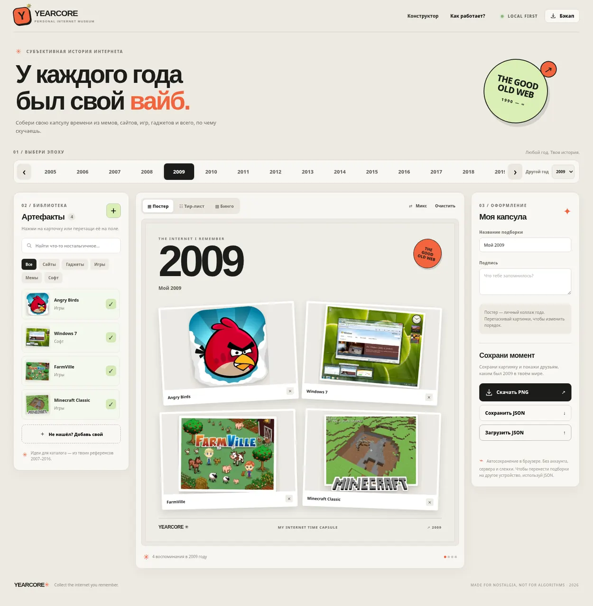
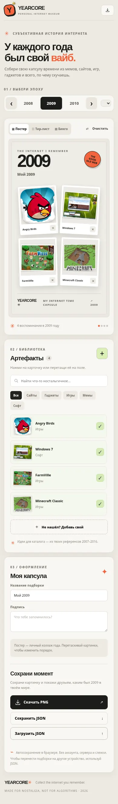
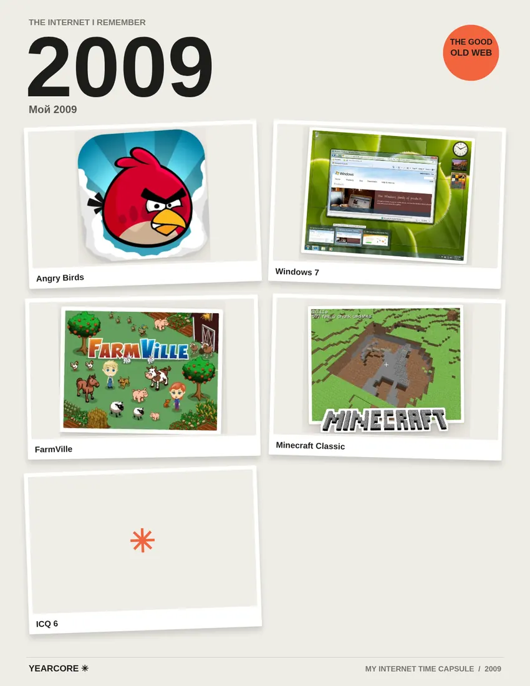

# YEARCORE

**Personal Internet Time Capsule** — конструктор воспоминаний об интернете, мемах, технологиях, играх и гаджетах по годам.



**Poster · Tier list · Bingo** · **100% static** · **Local-first** · **No account required**

YEARCORE помогает собрать собственную версию каждого года: не объективную историю трендов, а именно то, что запомнилось тебе. Идея вдохновлена ностальгическими коллажами с событиями и артефактами 2007–2016 годов.

## Возможности

| Функция | Описание |
| --- | --- |
| Годы | 1980–2035; примеры для 2007–2016 |
| Постер | Персональный коллаж любимых трендов |
| Тир-лист | Рейтинг карточек по уровням S / A / B / C / D |
| Бинго | Сетки 3×3, 4×4 и 5×5 |
| Свои карточки | Имя, категория, файл изображения или HTTPS-ссылка |
| Сохранение | Автоматически в `localStorage` браузера |
| Экспорт | PNG для публикации, JSON для резервной копии и переноса |
| Развёртывание | GitHub Pages — без сервера, npm и внешнего API |

<details>
<summary>Мобильный интерфейс и пример постера</summary>




</details>

## Быстрый старт

```bash
git clone https://github.com/IlyaBOT/yearcore.git
cd yearcore
python -m http.server 8080
```

Открой [http://localhost:8080](http://localhost:8080). Можно также открыть
`index.html` напрямую, но для работы с изображениями и PNG-экспортом лучше HTTP.

## GitHub Pages

После загрузки файлов в репозиторий:

1. Открой **Settings → Pages**.
2. Выбери **Deploy from a branch** → `main` → `/(root)`.
3. Сохрани настройки; после публикации адрес будет
   **https://ilyabot.github.io/yearcore/**.

GitHub Pages поддерживает собственные домены, в том числе
`yearcore.ilyabot.space`. DNS-запись `CNAME` должна указывать на
`IlyaBOT.github.io` (без имени репозитория).

Подробно: **[docs/DEPLOYMENT.md](docs/DEPLOYMENT.md)**.

## Структура

```text
yearcore/
├── index.html              интерфейс
├── styles.css              адаптивные стили
├── script.js               каталог, редактор и экспорт
├── favicon.svg
├── .nojekyll               отключение обработки Jekyll
├── assets/                 стартовый набор иллюстраций
│   └── NOTICE.md           права на сторонние материалы
├── docs/
│   ├── screenshots/        скриншоты для README
│   ├── social-preview.png  карточка предпросмотра GitHub
│   └── DEPLOYMENT.md       GitHub Pages и DNS
├── .github/ISSUE_TEMPLATE/ шаблоны Issues
├── CONTRIBUTING.md
├── CHANGELOG.md
├── LICENSE
└── README.md
```

## Ограничения MVP

- Нет аккаунтов, общей базы трендов и синхронизации между браузерами.
- Данные `localStorage` пропадут при очистке хранилища сайта.
- Сторонние URL-изображения могут не войти в PNG из-за ограничений CORS.
- Встроенные изображения и логотипы взяты из предоставленных коллажей:
  перед публичным распространением необходимо проверить права на их использование.

## Разработка

Проект намеренно не использует фреймворк и сборщик: вносить изменения можно
непосредственно в HTML, CSS и JavaScript. См. [CONTRIBUTING.md](CONTRIBUTING.md).

**Планируемое развитие:** расширяемый каталог по годам, темы оформления,
ссылки на готовые коллекции, пользовательские профили и синхронизация.

## Лицензия

Исходный код и документация — **MIT** (см. [LICENSE](LICENSE)).
Права на сторонние изображения, логотипы, марки и другие материалы
не передаются по этой лицензии — см. [assets/NOTICE.md](assets/NOTICE.md).
